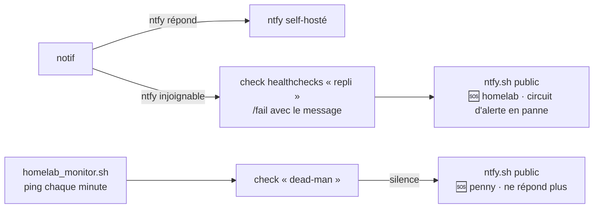

# Notifications — un seul langage

Depuis le 2026-11-06, **toute notification du homelab passe par un seul outil, `notif`**.
Une panne se lit pareil quelle que soit la source (script de penny, LXC, Grafana,
n8n, Pulse, Proxmox), et chaque problème a sa résolution.

Cette page dit *comment c'est fait et pourquoi*. Le mode « silence sauf panne » et le
canary externe sont dans [Notif hygiene](notif-hygiene.md) ; le serveur lui-même dans
[ntfy](../services/ntfy.md) ; les sondes dans [Monitoring](monitoring.md).

## Pourquoi

Avant, une quarantaine d'émetteurs avaient chacun leur `curl` : trois styles de titre,
du Markdown affiché brut sur l'iPhone, des accents cassés, et surtout **un problème
arrivait mais sa résolution, le plus souvent, se taisait**. L'outil commun est le seul
endroit qui connaît le point d'entrée, le jeton, le format, la priorité et l'état des
incidents ouverts. Les scripts disent *quoi* ; jamais *comment*.

## La grammaire

**Titre** : `<machine> · <sujet>`, en français, accents, casse normale. La machine
d'abord, parce que sur un écran verrouillé *où* est l'information utile. Sans machine
unique (CI, miroir GitHub, DNS du réseau) : `homelab · <sujet>`.

**Emoji d'état**, posé par une étiquette ntfy :

| État | Étiquette | Sens |
|---|---|---|
| 🔴 | `red_circle` | problème, en attente de sa résolution |
| 🟢 | `green_circle` | résolution |
| 🟠 | `orange_circle` | événement sans retour possible (OOM kill, nouveau sous-domaine CT, CVE trouvée) : pas de paire, jamais effacé |
| 🔵 | `blue_circle` | information (résumé quotidien, veille GitHub, correctif appliqué) |

Viennent ensuite trois étiquettes texte : **machine**, **domaine** et **service**.
Le domaine vient d'une liste fermée : `sauvegarde`, `sécurité`, `réseau`, `matériel`,
`stockage`, `conteneurs`, `ci`, `dépôt`, `mises-à-jour`, `supervision`, `rapport`.

**Corps** : deux lignes au plus (quoi, depuis quand, quoi faire si c'est évident),
**sans Markdown** (l'appli iOS l'affiche brut). Le détail long part en pièce jointe
`detail.txt`. Un bouton ou un lien au toucher n'existe que s'il mène quelque part d'utile.

## Les priorités

La priorité décrit le **problème**, pas le script.

| Priorité | Sens | Effet voulu |
|---|---|---|
| 5 urgente | perte de données ou de service en cours : penny ou un nœud hors ligne, SSD perdu | **réveille la nuit** |
| 4 haute | vrai problème à traiter dans la journée : sauvegarde en échec, CI rouge, disque > 90 % | sonne en journée |
| 3 normale | à savoir : dérive, mise à jour en attente | notification normale |
| 2 basse | rien à faire : **toutes les résolutions** et les informations | arrive sans sonner |
| 1 minimale | jamais utilisée : si ça ne vaut pas 2, on n'envoie pas | — |

Une résolution est **toujours en 2**, même celle d'un problème en 5. Pour que seul le 5
traverse la nuit, un réglage iPhone est nécessaire. Dans le code de l'appli ntfy iOS, le
4 est « time-sensitive » et le 5 aussi, sauf si les *Critical Alerts* sont activées dans
l'appli : alors le 5 devient « critical » et seul lui perce le mode Concentration.

## L'outil `notif`

Python stdlib, versionné dans `homelab-config` (`scripts/notif.py`), déployé sur penny
et dans les 3 LXC de sauvegarde (`scripts/lxc/deploy.sh`).

```bash
notif probleme --cle <incident> --machine penny --domaine sauvegarde \
      --service restic --gravite 4 --sujet "Sauvegarde en échec" --detail "..."
notif resolu   --cle <incident>        # le sujet est repris de l'incident ouvert
notif evenement --machine ... --domaine ... --service ... --gravite 3 --sujet "..."
notif info      --machine ... --domaine ... --service ... --sujet "..."
notif purger                            # appelé par le timer, pas à la main
```

Ce qu'il fait pour vous : publication JSON (accents corrects), jeton, titre et
étiquettes, priorité, **clé d'incident** par occurrence (une récidive du lendemain n'est
pas la même paire que celle de la veille), et état des incidents ouverts dans
`/var/lib/notif`.

Variables utiles : `NOTIF_DRY_RUN=1` (affiche le JSON, aucun envoi), `NOTIF_TOPIC`
(défaut `homelab`), `NOTIF_URL`, `NOTIF_STATE_DIR`.

**Codes de sortie** : 0 livré, 2 usage, 3 livré par le repli, 4 non livré (l'incident
reste ouvert, la résolution partira plus tard).

### La résolution attend 10 minutes de calme

Un « rétabli » prématuré, suivi d'une rechute, est pire que pas de message. La résolution
n'est annoncée qu'après **10 minutes de stabilité** ; le timer `notif-purger` passe toutes
les 5 minutes, donc le 🟢 arrive au plus ~15 minutes après le retour au vert. Une
condition qui oscille reste digeste.

### Topic d'essai

Les essais vont sur **`homelab-essai`** (`NOTIF_TOPIC=homelab-essai`), jamais sur
`homelab`, pour ne pas faire sonner. Ses droits ntfy (`publisher` lecture-écriture,
`phone` lecture seule) sont posés dans `user.db`, **pas versionnés** : à refaire si la
base est recréée.

## L'effacement des paires : construit, éteint

Prévu : une paire problème + résolution disparaît **12 h après la résolution** (un
incident de 2 h du matin est encore là au réveil, le fil est propre le soir). Un
problème non résolu n'est jamais effacé.

**C'est éteint**, parce que l'appli iOS n'applique pas les effacements à distance et
affiche chaque ordre d'effacement comme **une notification vide** (testé le 2026-11-06).
Allumer maintenant remplirait le fil de notifications vides.

Pour l'allumer le jour où l'appli suit :

1. **Vérifier d'abord sur l'iPhone** : sur `homelab-essai`, envoyer un problème puis sa
   résolution, forcer l'effacement, constater que la notification disparaît **sans
   laisser de notification vide**.
2. Poser `Environment=NOTIF_EFFACEMENT=1` dans l'unité `notif-purger.service`
   (`system/systemd/` dans `homelab-config`, par branche + PR), puis
   `systemctl daemon-reload`.

Sans cette variable, l'outil n'efface rien : c'est l'unique interrupteur.
Même allumé, un effacement ntfy ne retire pas le message du cache serveur : le résumé
quotidien de 19 h voit toujours les incidents de la nuit.

## Le canal de secours

Si ntfy est lui-même injoignable, l'alerte ne peut plus passer par lui. Deux filets,
volontairement **séparés** :



- **Dead-man de penny** : réservé à `homelab_monitor.sh`. S'il sonne, penny est muet.
- **Repli** : check **dédié**, dont l'URL est dans `/etc/homelab/healthchecks-repli-url`
  (0600 root). `notif purger` le pingue quand ntfy est sain, et `/fail` quand il ne
  l'est pas. Ne **jamais** utiliser le dead-man pour cela : un `/fail` d'un autre script
  fait croire que penny est mort, puis le « répare » (fausse alerte réelle du 22/09).
- **Ne jamais tester en déclenchant** : un `/fail` réel est une vraie alerte 🆘. Tester
  par simulation (`NOTIF_DRY_RUN`, fichier d'URL de test).

Le canal public (healthchecks.io vers un topic de **ntfy.sh**) est **voulu et gardé** : il
doit marcher quand penny, Docker ou le SSD sont morts. L'intégration « ntfy » native de
healthchecks.io force le Markdown ; elle est remplacée par une intégration **Webhook**
qui publie en JSON avec la même grammaire, en tête 🆘 : panne en priorité 5, retour en 2.
Le topic de secours n'est écrit nulle part dans le dépôt.

## Ce qui a disparu

L'ancien relais Grafana vers ntfy.sh public (`ntfy-relay`, penny, port 8095) a été
retiré le 2026-11-06, après vérification qu'aucune source ne l'utilisait. Le relais
Grafana actuel est celui du LXC 101.

## Où voir le code

Dans `homelab-config` : `scripts/notif.py`, `system/systemd/notif-purger.*`,
`system/proxmox/notifications-webhook.md` (notifications natives PVE/PBS),
`system/lxc-scripts/README.md`, `n8n/workflows/README.md`,
`logs/logs-prod-1/ntfy-relay/README.md`.
