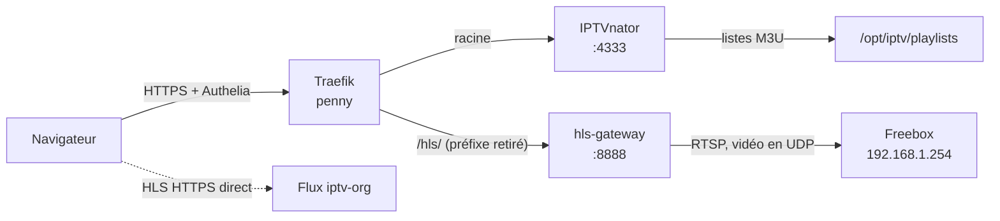

# IPTV — LXC 109

Lecteur de chaînes TV dans le navigateur ([IPTVnator](https://github.com/4gray/iptvnator)),
alimenté par deux sources légales : les chaînes de la **Freebox TV** et les chaînes
francophones gratuites d'**[iptv-org](https://github.com/iptv-org/iptv)**. Mis en service
le 2026-10-26.

| | |
|---|---|
| LXC | 109 `iptv`, sur **galahad** — `192.168.1.37` |
| URL | `iptv.home.gabin-simond.fr`, derrière Authelia |
| Config | `homelab-config/iptv/`, déployée par **copie** dans `/opt/iptv` du LXC |
| Route | `homelab-config/traefik/dynamic/iptv.yml` |
| GPU | `/dev/dri/renderD128` de galahad, passé au LXC (QuickSync via VAAPI) |

## Architecture



- **IPTVnator** (Docker, digest épinglé) : l'interface. Il lit deux listes servies par
  son propre nginx : `freebox.m3u` (495 chaînes) et `iptv-org-fr.m3u` (376 chaînes).
- **hls-gateway** (service systemd, Python sans dépendance) : lance un `ffmpeg` par
  chaîne regardée, l'arrête 30 s après le dernier spectateur. Trois flux au plus.
- **gen-playlists** (timer quotidien, 05:15) : régénère les deux listes. Une source en
  échec garde la liste de la veille plutôt que d'écrire une liste vide.

**Interface et flux partagent la même origine** (`/hls/` sous le même hôte). Sur un
sous-domaine séparé, les requêtes vidéo du lecteur partiraient sans le cookie Authelia
et prendraient un 302.

## Pourquoi une passerelle

La Freebox ne sert ses chaînes qu'en **RTSP**, qu'aucun navigateur ne lit. La passerelle
convertit à la demande en **HLS**. Le chemin a été trouvé par élimination — chaque impasse
ci-dessous est mesurée, pas supposée :

| Essai | Résultat | Conclusion |
|---|---|---|
| RTSP en TCP | `461 Unsupported Transport` | La Freebox impose l'UDP |
| Vidéo attendue de `192.168.1.254` | `could not find codec parameters` | La vidéo arrivait de **212.27.38.253** — `tcpdump` sur `vmbr0` l'a montré |
| Son AAC copié tel quel | `AAC with no global headers` | Trames atypiques ; le son est réencodé |
| `-map 0:a:m:language:fra?` | `Invalid argument` (ffmpeg 7.1) | Sélecteur sans `?`, repli sur la 1re piste |
| MediaMTX (RTSP puis SRT) | `DTS is not monotonically increasing` | Son muxer HLS recalcule le DTS et casse ; ffmpeg seul garde celui d'origine |
| Vidéo copiée (1080i) | **Son sans image sur iPhone** | Voir ci-dessous |

### La vidéo est désentrelacée sur le GPU

Toutes les images Freebox sont **entrelacées** (1440×1080 à pixels 4:3). Le décodeur de
l'iPhone ne lit pas le H.264 entrelacé : le son passe, chaque image est rejetée. La vidéo
est donc décodée, désentrelacée, mise à l'échelle et réencodée **sur le GPU Intel** du
N150 :

```text
-hwaccel vaapi -vf deinterlace_vaapi=rate=frame:auto=1,scale_vaapi=w=1920:h=1080
-c:v h264_vaapi -low_power 1 -b:v 6M -g 50
```

Sortie 1920×1080 progressive à pixels carrés, **1,07× temps réel, ~10 % d'un cœur** par
chaîne. Le passage du GPU au LXC :

```bash
pct set 109 -dev0 /dev/dri/renderD128,gid=992,mode=0660   # 992 = groupe render DANS le LXC
```

…plus `intel-media-va-driver` dans le LXC et `SupplementaryGroups=render` dans l'unité.

### La Freebox, par son adresse LAN

La passerelle joint la box sur **`192.168.1.254`**, pas sur `mafreebox.freebox.fr`. Le
2026-10-26 au soir, après un changement de réglages DHCP, la box a cessé de répondre en
RTSP (port 554) sur l'alias `212.27.38.253`, alors que l'adresse LAN répondait : toutes
les chaînes Freebox tombaient en 504, iptv-org restant intact.

## Sécurité

- **Pare-feu Proxmox du LXC** (`/etc/pve/firewall/109.fw`, versionné en
  `iptv/pve-firewall-109.fw`) : les ports 4333 et 8888 ne sont ouverts **qu'à penny**.
  Publier sur le LAN contournerait Authelia. Vérifié : depuis lancelot, refusé.
  Le RTP de la Freebox est autorisé en UDP depuis `212.27.38.253` et `192.168.1.254`.
- `IPTVNATOR_PROXY_ALLOW_PRIVATE_NETWORKS=true` : nécessaire pour que le backend lise les
  listes sur `127.0.0.1`. Risque résiduel (requêtes vers le LAN) borné par Authelia.
- **Service worker coupé.** IPTVnator est une PWA : son service worker resservait
  l'interface depuis le cache de Safari après l'expiration de la session Authelia
  (30 min d'inactivité), sans repasser par le serveur, donc sans redirection vers la
  connexion. Symptôme : textes en clés brutes (`HOME.PLAYLISTS…`), icônes en texte,
  listes vides. Le modèle nginx de l'image est monté avec `ngsw.json` en **404** — le
  service worker Angular se désinstalle alors de lui-même — et `index.html` en
  `no-cache`.

## Le piège DHCP

:::danger[Une IP fixe dans la plage DHCP de la Freebox finit par être réattribuée]
Le 2026-10-26, quelques heures après la création du LXC, la Freebox a donné
`192.168.1.37` à un autre appareil en Wi-Fi. Symptôme : 502 Traefik par intermittence,
et un ping vers `.37` à **70 ms** au lieu de 0,25 ms — c'était l'autre appareil qui
répondait. La plage DHCP couvrait `.2` à `.200`, donc **toutes** les IP fixes du parc.

Elle est désormais **`.100` à `.200`**. Règle : toute nouvelle IP fixe se prend
**sous `.100`**. Un bail statique par machine protège aussi, mais seulement si on pense à
l'ajouter à chaque création : la plage réduite n'a rien à oublier.

Pour vérifier qu'une IP fixe répond avec la bonne carte :

```bash
ip neigh flush to 192.168.1.37 && ping -c1 192.168.1.37 >/dev/null && ip neigh show 192.168.1.37
# lladdr attendu : la hwaddr de `pct config 109`
```
:::

## Exploitation

**Ajouter les listes dans IPTVnator** (une seule fois, par URL — pas par le nom de
domaine, qui tomberait sur Authelia) :

```text
http://127.0.0.1/playlists/freebox.m3u
http://127.0.0.1/playlists/iptv-org-fr.m3u
```

**Diagnostiquer** (depuis penny) :

```bash
tailscale ssh root@galahad "pct exec 109 -- journalctl -u hls-gateway -n 20 --no-pager -o cat"
tailscale ssh root@galahad "pct exec 109 -- curl -s http://127.0.0.1:8888/healthz"   # « ok N flux »
# une chaîne de bout en bout, sans navigateur :
tailscale ssh root@galahad "pct exec 109 -- curl -s -o /dev/null -w '%{http_code}\n' http://127.0.0.1:8888/fbx_201_hd/index.m3u8"
```

Les erreurs fatales de chaque `ffmpeg` sont dans `/run/hls-gateway/<chaîne>/ffmpeg.log`
tant que la chaîne tourne. Traefik ne journalise que les réponses **400-599** : une
chaîne qui marche n'apparaît pas dans ses logs.

**Tester depuis penny ne sert à rien** : son pare-feu (`INPUT DROP`) bloque le RTP UDP
renvoyé par la Freebox, et l'analyse reste bloquée sans erreur.

## Limites connues

- **Trois chaînes Freebox simultanées** au plus : la box limite le multiposte.
- Sur les 495 chaînes Freebox, celles **hors abonnement** ne démarrent pas.
- **iptv-org** : seuls les flux **HTTPS** sont gardés (un flux `http://` est bloqué comme
  contenu mixte), et une partie tombe régulièrement — c'est la nature de la liste.
- Les sources **Xtream / Stalker** qu'IPTVnator sait lire ne sont pas couvertes ici :
  ces abonnements sont, dans leur immense majorité, des reventes sans droits.
